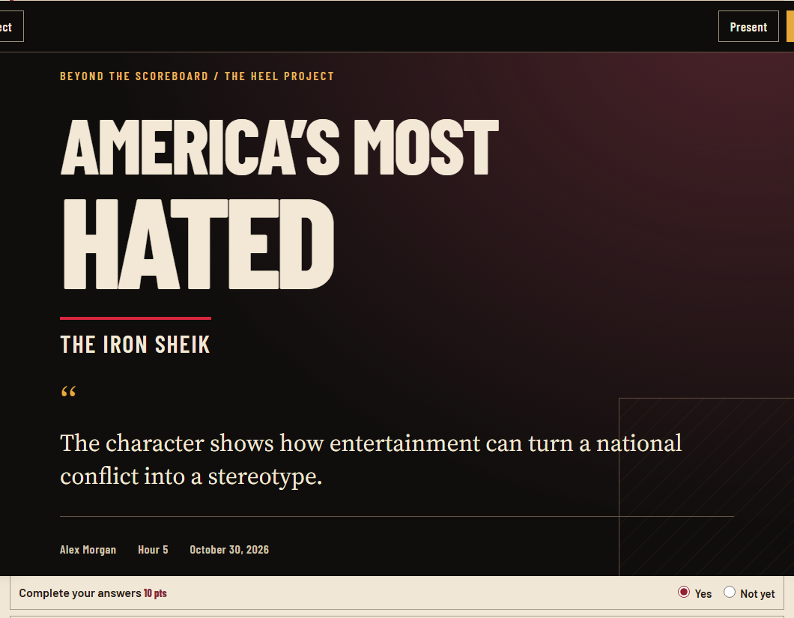
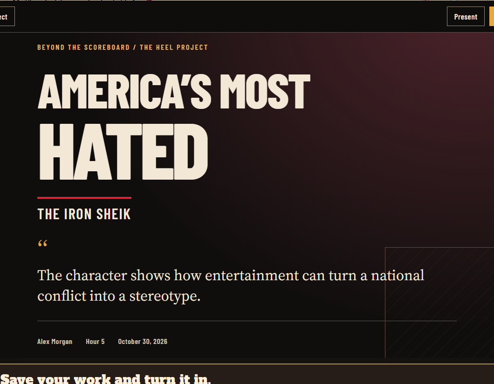

# Heel personal report acceptance

All names and work in these files are invented test fixtures. No school account, student record or live Turn In endpoint is used.

Run `node scripts/test-heel-report-browser.cjs` to reproduce. The normal `npm run browser:test` now includes this acceptance test. Its full size frames, all three PDFs and machine results are written to `browser-results/heel-report/` and included in the existing GitHub `browser-acceptance` artifact.

| Fixture | Coverage | 1366 by 768 slides | 1920 by 1080 slides |
| --- | --- | --- | --- |
| A | All five rounds, 24 realistic written answers, nine self-check choices | 15 | 15 |
| B | 400+ words, three words, line breaks, literal script and bold tags, emoji and quotation marks | 22 | 21 |
| C | Two whole rounds empty | 10 | 10 |

All six journeys pass with zero console or page errors. Assertions compare every answer byte for byte in the read view and after combining all presentation fragments. The tests check text boundaries and overflow on every slide, actual fullscreen, arrow keys, space, mouse, tap, Escape, empty-step return links, earlier edits, reload, report identity storage and exclusion from existing submission data. Additional stress checks verify a 520-word sentence and a 1200-character unbroken URL without losing graphemes. Report accessibility passes WCAG A/AA at 320, 390 and 1366 pixels. The PDF button is verified to call `window.print()`.

Each read sheet contains the cover and all five sections. Each presentation sheet contains every slide at the named resolution. The PDFs use the actual print stylesheet and US Letter pages. Normal output has six pages. Long writing flows across additional pages. Empty sections and unfinished notes are omitted in print and presentation. PDF pages were rendered for visual review, including spacing, escaping, emoji, pagination and headings.

A main claim with a first sentence longer than 60 words is preserved intact in an opening section instead of stretching the title card over several pages. A separate 520-word claim print fixture verifies this path.

| Test | Read screenshots | Presentation screenshots | PDF |
| --- | --- | --- | --- |
| A | [1366](TestA-read-1366.webp) · [1920](TestA-read-1920.webp) | [1366](TestA-present-1366.webp) · [1920](TestA-present-1920.webp) | [Test A report](TestA-report.pdf) |
| B | [1366](TestB-read-1366.webp) · [1920](TestB-read-1920.webp) | [1366](TestB-present-1366.webp) · [1920](TestB-present-1920.webp) | [Test B report](TestB-report.pdf) |

